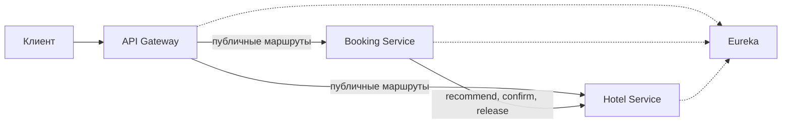
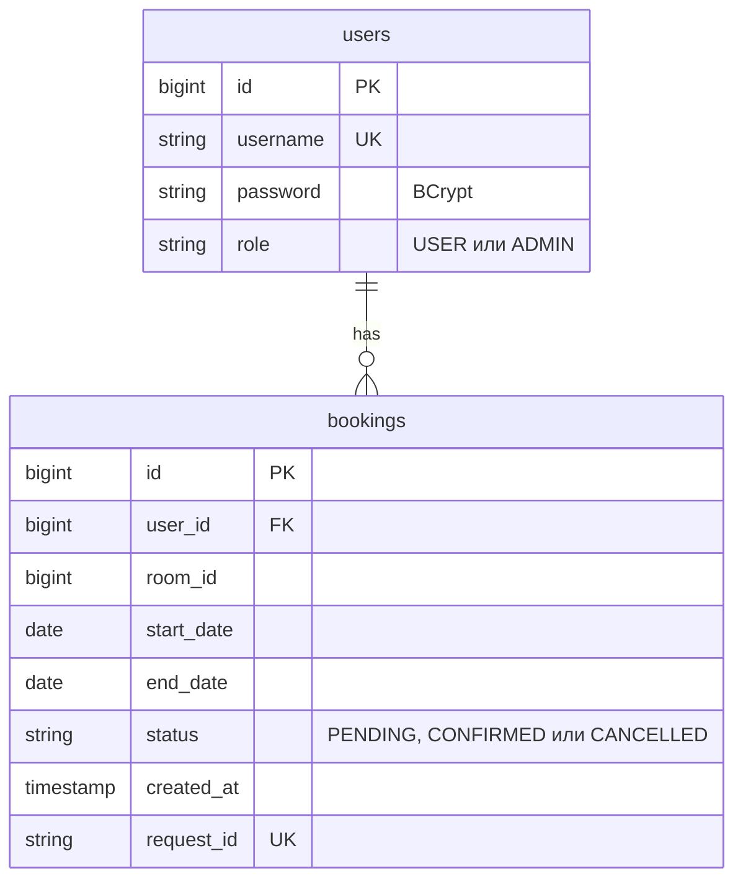
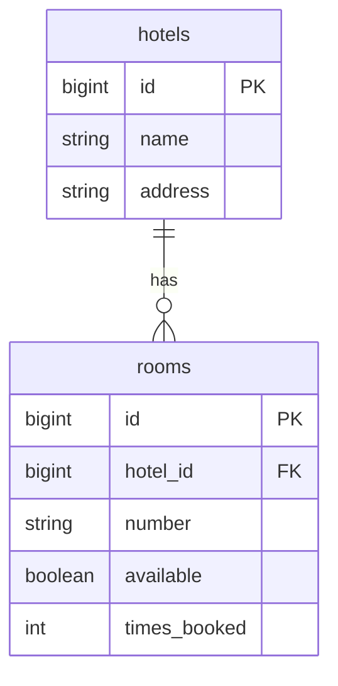
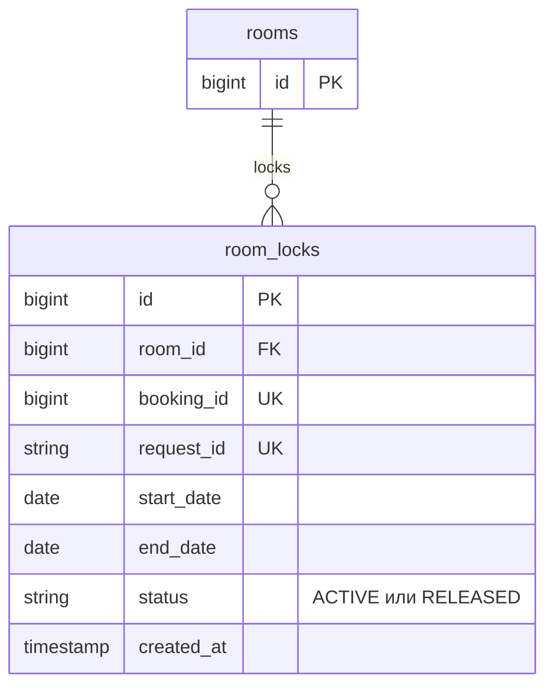

# Система бронирования отелей

Система принимает заявки на номера и ведет справочник отелей. Она собрана из четырех приложений и общей библиотеки, потому что реестр, шлюз, бронирование и отели должны жить отдельными процессами, а формат ошибок и проверка JWT не должны копироваться в каждый из них.

Клиент обращается только к шлюзу. Шлюз находит Booking и Hotel через Eureka и передает дальше заголовок Authorization, если клиент его прислал. Подпись токена шлюз не разбирает, так как каждый бизнес-сервис сам решает, достаточно ли роли для операции. Booking вызывает Hotel напрямую по имени hotel-service, потому что подтверждение доступности и снятие блокировки остаются внутренним шагом саги.



Сплошные стрелки на схеме показывают вызовы с бизнес-данными, а пунктир показывает только регистрацию в реестре. Библиотека common процессом не является, однако ее классы попадают в jar шлюза, Booking и Hotel.

## Запуск

Для локального запуска нужен JDK 17. Команды выполняются из каталога system, так как там лежит корень Gradle с именем hotel-booking.

Сначала поднимается реестр, затем остальные процессы, потому что клиенты регистрируются в Eureka и без нее не находят друг друга.

```bash
./gradlew :eureka-server:bootRun
./gradlew :api-gateway:bootRun
./gradlew :booking-service:bootRun
./gradlew :hotel-service:bootRun
```

Шлюз слушает порт 8080, Booking слушает 8081, Hotel слушает 8082, а Eureka слушает 8761. Эти порты заданы в application.yml и окружением не переопределяются.

Тот же набор можно поднять одним Docker Compose, так как внешняя база не нужна и контейнеры видят друг друга по своим именам. Из каталога system выполняется следующая команда.

```bash
docker compose up --build
```

Первый запуск долгий, потому что каждый образ собирает свой jar внутри Docker. Контейнеры стартуют сразу после Eureka, однако реестр принимает регистрацию не мгновенно, поэтому запрос в первые секунды может получить 503, пока Booking и Hotel не появятся в реестре. Данные H2 живут в памяти процесса и пропадают вместе с ним.

Проверка тестов и единого форматирования тоже идет из каталога system.

```bash
./gradlew test checkFormat
```

## Как обратиться к системе

Точка входа для клиента находится по адресу http://localhost:8080. Регистрация и вход не требуют токена. Остальные запросы к шлюзу без заголовка Authorization получают 401.

Вход выполняется запросом POST /api/user/auth. Тело содержит username и password.

```json
{
  "username": "user1",
  "password": "user1"
}
```

В ответе приходит token со сроком жизни один час. Дальше заголовок называется Authorization, а его значение начинается со слова Bearer и этого token.

На старте уже есть три пользователя. Администратор входит как admin с паролем admin. Обычные пользователи входят как user1 с паролем user1 и user2 с паролем user2. У user1 есть подтвержденная бронь номера 103 и отмененная бронь номера 102, а у user2 есть подтвержденная бронь номера 201, поэтому на этих записях видно и свою историю, и запрет чужой брони.

Описание API Booking открывается на http://localhost:8081/swagger-ui.html, а описание API Hotel открывается на http://localhost:8082/swagger-ui.html. Через шлюз эти страницы не опубликованы, так как его маршруты покрывают только префиксы /api/user, /api/booking, /api/bookings, /api/hotels и /api/rooms. Состояние реестра видно на http://localhost:8761.

## Данные

У Booking и Hotel отдельные базы H2, поэтому общего внешнего ключа между ними нет. Поле bookings.room_id хранит номер как число.



Индекс idx_bookings_user_created_id по user_id, created_at и id обслуживает страницу истории.



Пара hotel_id и number уникальна. Индекс idx_rooms_recommendation по available, times_booked и id обслуживает рекомендацию. available означает ремонт или вывод из эксплуатации и к занятости по датам отношения не имеет.



Индекс idx_room_locks_overlap по room_id, status, start_date и end_date нужен для поиска пересечения. Пересечение считается только по ACTIVE и по полуоткрытому интервалу, так как дата заезда входит, а дата выезда свободна.

На старте Hotel создает отели Hotel A и Hotel B с адресами Address A и Address B. Номера 101, 102 и 103 относятся к Hotel A, номер 104 того же отеля снят с эксплуатации, а номер 201 относится к Hotel B. Счетчик times_booked равен 1 у номеров 103 и 201 и равен 0 у остальных, поэтому рекомендация среди доступных номеров идет в порядке 101, 102, 103, 201.

## Ключевые решения

Общий код вынесен в библиотеку common, потому что ErrorDTO, разбор JWT и имя заголовка трассировки нужны трем процессам, но сами по себе запросы не обрабатывают.

Согласованность сделана сагой из локальных транзакций, потому что глобальная транзакция между сервисами не используется. Booking сначала фиксирует строку в статусе PENDING, затем вызывает подтверждение доступности. Успех переводит бронь в CONFIRMED. Конфликт или отсутствие номера переводят ее в CANCELLED без вызова release, так как блокировка в этих случаях не создается. Таймаут, ответ 5xx или открытый breaker приводят к release и затем к CANCELLED. Если сам release не удался, бронь остается в прежнем статусе, чтобы повтор отмены мог снять блокировку еще раз.

Повторы подтверждения и снятия блокировки разделены на два контура, потому что отказ контура подтверждения не должен запрещать компенсацию. Повторяются обрыв, таймаут и 5xx, а ответы 409 и 404 не повторяются и breaker не открывают. Повтор одного requestId возвращает уже сохраненную бронь и второй раз Hotel не вызывает, так как этот идентификатор уникален и в bookings, и в room_locks.

Автоподбор останавливается на первом номере рекомендации. Если этот номер занят на запрошенные даты, бронь завершается, потому что порядок рекомендации уже задан возрастанием times_booked, а при равенстве счетчика меньшим id. Счетчик растет на 1 только при новом успешном подтверждении и при отмене не уменьшается, так как он считает число подтверждений, а не текущую занятость.

Шлюз проверяет только наличие заголовка Authorization на закрытых маршрутах и создает X-Trace-Id, если клиент его не прислал. Подпись и роль проверяют Booking и Hotel, потому что решение о доступе принимается там, где выполняется операция, через resource server и @PreAuthorize. Токен подписывается HMAC в Booking, живет один час и отдельно не продлевается, поэтому следующий токен выдается входом или регистрацией. Один и тот же секрет лежит в конфигурации Booking и Hotel, так как Hotel должен принять токен, который выпустил Booking.

Шлюз на пути, который заканчивается на confirm-availability или release, отвечает 404 до проверки токена, поэтому эти вызовы остаются прямым обращением Booking к Hotel внутри одной сети.
